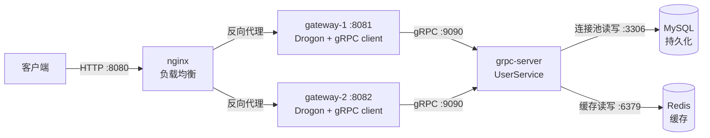

>本项目在迭代完善中，项目代码在 https://github.com/grassro0t/httpserver-demo
# 1. 基本架构
- 特性：
	- 分层设计
	- 负载均衡
	- 双写缓存+连接池
	- RAII守卫

- 数据流：`curl` → nginx 轮询选中某个 gateway → gateway 通过 gRPC 调 grpc-server → `UserRepository` 先查 Redis 缓存，未命中再查 MySQL 并回填 → 逐层返回（响应带 `X-Gateway-Instance` 头标识处理实例）。
# 2. 核心方法
- 需要同时启动网关的应用程序和grpc应用程序
- 工具：见代码详解
- drogon：
	- GatewayContext
	- UserController
		- createUser等接口
	- GrpcClient：grpc客户端
	- MakeJsonResponse：response返回封装
- grpc：
	- UserServiceImpl：grpc服务器
		- createUser等接口
- 数据访问层
	- UserRepository
		- createUser等接口
		- InvalidateListCache：删除列表cache
	- MysqlPool
		- init：池初始化
		- acquire：获取连接
		- release：释放连接（RAII守卫自动释放）
	- RedisClient
		- Command：将void\*返回值转为redisReply\*返回
# 3. 代码详解
# 工具函数
- nlohmann的json序列化反序列化工具
- 命令行参数解析工具
``` cpp
inline nlohmann::json UserToJson(const user::v1::User& u) {
  return nlohmann::json{
      {"id", u.id()}, {"name", u.name()}, {"email", u.email()}, {"created_at", u.created_at()}};
}

inline std::string UserToJsonString(const user::v1::User& u) { return UserToJson(u).dump(); }

inline void JsonToUser(const nlohmann::json& j, user::v1::User* u) {
  u->set_id(j.value("id", ""));
  u->set_name(j.value("name", ""));
  u->set_email(j.value("email", ""));
  u->set_created_at(j.value("created_at", static_cast<int64_t>(0)));
}

// 解析 "--key=value" 形式的命令行参数
std::map<std::string, std::string> ParseArgs(int argc, char** argv);

// 取参数，缺失时返回默认值
std::string GetArg(const std::map<std::string, std::string>& args, const std::string& key,const std::string& def);
```
## Drogon网关
- 上下文
	- 单例模式懒汉式
	- 持有grpc client
``` cpp
// 网关全局上下文（单例）：持有配置与 gRPC client，
// 供 Drogon 控制器在各 handler 中访问。
class GatewayContext {
 public:
  static GatewayContext& instance();

  void init(const GatewayConfig& cfg) {
    cfg_ = cfg;
    grpc_.connect(cfg_.grpc_addr);
  }

  GrpcClient& grpc() { return grpc_; }
  const std::string& instanceId() const { return cfg_.instance_id; }
  const std::string& grpcAddr() const { return cfg_.grpc_addr; }

 private:
  GatewayContext() = default;
  GatewayConfig cfg_;
  GrpcClient grpc_;
};
```
- grpc client
	- 每个行为函数调用grpc client接口
``` cpp
// 封装 grpc::UserService 的同步 stub，屏蔽 gRPC 细节
class GrpcClient {
 public:
  GrpcClient() = default;
  ~GrpcClient() = default;

  GrpcClient(const GrpcClient&) = delete;
  GrpcClient& operator=(const GrpcClient&) = delete;

  bool connect(const std::string& server_addr);

  RpcStatus CreateUser(const std::string& name, const std::string& email, user::v1::User* out);
  RpcStatus GetUser(const std::string& id, user::v1::User* out);
  RpcStatus ListUsers(int limit, int offset, std::vector<user::v1::User>* out, int64_t* total);
  RpcStatus GetStats(int64_t* total_users, int64_t* request_count);

  const std::string& lastError() const { return err_; }

 private:
  std::unique_ptr<user::v1::UserService::Stub> stub_;
  std::string err_;
};

// gRPC 调用结果分类，便于网关层映射 HTTP 状态码
enum class RpcStatus { kOk, kNotFound, kError };

RpcStatus GrpcClient::CreateUser(const std::string& name, const std::string& email,user::v1::User* out) {
  user::v1::CreateUserRequest request;
  user::v1::CreateUserReply reply;
  request.set_name(name);
  request.set_email(email);

  grpc::ClientContext ctx;
  ctx.set_deadline(std::chrono::system_clock::now() + kRpcTimeout);
  grpc::Status s = stub_->CreateUser(&ctx, request, &reply);
  if (s.ok()) {
    *out = reply.user();
    return RpcStatus::kOk;
  }
  err_ = s.error_message();
  return RpcStatus::kError;
}
```
- 控制器
	- 奇异递归模板
	- 对外提供restful接口，对内提供grpc服务调用
``` cpp
// Drogon HTTP 控制器：对外 REST API，内部经 gRPC 调用业务服务
class UserController : public drogon::HttpController<UserController> {
 public:
  METHOD_LIST_BEGIN
  ADD_METHOD_TO(UserController::createUser, "/api/v1/users", drogon::Post);
  ADD_METHOD_TO(UserController::getUser, "/api/v1/users/{id}", drogon::Get);
  ADD_METHOD_TO(UserController::listUsers, "/api/v1/users", drogon::Get);
  ADD_METHOD_TO(UserController::getStats, "/api/v1/stats", drogon::Get);
  ADD_METHOD_TO(UserController::health, "/healthz", drogon::Get);
  METHOD_LIST_END

  void createUser(const drogon::HttpRequestPtr& req,
                  std::function<void(const drogon::HttpResponsePtr&)>&& callback);
  void getUser(const drogon::HttpRequestPtr& req,
               std::function<void(const drogon::HttpResponsePtr&)>&& callback);
  void listUsers(const drogon::HttpRequestPtr& req,
                 std::function<void(const drogon::HttpResponsePtr&)>&& callback);
  void getStats(const drogon::HttpRequestPtr& req,
                std::function<void(const drogon::HttpResponsePtr&)>&& callback);
  void health(const drogon::HttpRequestPtr& req,
              std::function<void(const drogon::HttpResponsePtr&)>&& callback);
};

void UserController::createUser(const drogon::HttpRequestPtr& req,
                                std::function<void(const drogon::HttpResponsePtr&)>&& callback) {
  auto body = req->getJsonObject();
  if (!body || !body->isObject() || !body->isMember("name")) {
    callback(ErrorResponse(drogon::k400BadRequest, "name is required"));
    return;
  }

  user::v1::User user;
  RpcStatus st = GatewayContext::instance().grpc().CreateUser((*body)["name"].asString(),
                                                              (*body)["email"].asString(), &user);
  if (st != RpcStatus::kOk) {
    callback(
        ErrorResponse(drogon::k502BadGateway,
                      "grpc CreateUser failed: " + GatewayContext::instance().grpc().lastError()));
    return;
  }
  callback(MakeJsonResponse(drogon::k201Created, UserToJsonString(user)));
}
```
- response返回封装（json）
``` cpp
// 公共响应外壳：注入实例标识头 + 统一 JSON 返回
drogon::HttpResponsePtr MakeJsonResponse(drogon::HttpStatusCode code, const std::string& body) {
  auto resp = drogon::HttpResponse::newHttpResponse();
  resp->setStatusCode(code);
  resp->setContentTypeCode(drogon::CT_APPLICATION_JSON);
  resp->addHeader("X-Gateway-Instance", GatewayContext::instance().instanceId());
  resp->setBody(body);
  return resp;
}
```
## grpc服务器
- 持有数据访问层对象
``` cpp
// UserService 的 gRPC 实现：业务逻辑通过 UserRepository 访问
// MySQL(持久化)+Redis(缓存)
class UserServiceImpl final : public user::v1::UserService::Service {
 public:
  explicit UserServiceImpl(std::shared_ptr<UserRepository> repo);

  grpc::Status CreateUser(grpc::ServerContext* context, const user::v1::CreateUserRequest* request,
                          user::v1::CreateUserReply* reply) override;

  grpc::Status GetUser(grpc::ServerContext* context, const user::v1::GetUserRequest* request,
                       user::v1::GetUserReply* reply) override;

  grpc::Status ListUsers(grpc::ServerContext* context, const user::v1::ListUsersRequest* request,
                         user::v1::ListUsersReply* reply) override;

  grpc::Status GetStats(grpc::ServerContext* context, const user::v1::GetStatsRequest* request,
                        user::v1::GetStatsReply* reply) override;

 private:
  std::shared_ptr<UserRepository> repo_;
};

grpc::Status UserServiceImpl::CreateUser(grpc::ServerContext* context,
                                         const user::v1::CreateUserRequest* request,
                                         user::v1::CreateUserReply* reply) {
  repo_->CountRequest();

  if (request->name().empty()) {
    return grpc::Status(grpc::StatusCode::INVALID_ARGUMENT, "name is required");
  }

  user::v1::User user;
  if (!repo_->CreateUser(request->name(), request->email(), &user)) {
    return grpc::Status(grpc::StatusCode::INTERNAL, "create user failed");
  }

  *reply->mutable_user() = std::move(user);
  return grpc::Status::OK;
}
```
## 数据访问层
- 实现cache aside策略：新增用户后删除缓存（所有列表）
``` cpp
// 依赖的两个底层组件（已有详细注释）：
//   MysqlPool    —— 连接池，acquire() 借连接 / Guard 自动归还（线程安全）
//   RedisClient  —— hiredis 封装，提供带 TTL 的缓存命令
class UserRepository {
 public:
  // 通过依赖注入获得连接池与缓存客户端；用 shared_ptr 便于在 service 层共享
  UserRepository(std::shared_ptr<MysqlPool> pool, std::shared_ptr<RedisClient> redis);

  // 创建用户（写路径）：先 INSERT MySQL，再写/失效缓存。成功返回 true，
  // 并把含数据库自增 id 的完整 User 通过 out 带回。
  bool CreateUser(const std::string& name, const std::string& email, user::v1::User* out);

  // 按 id 查单个用户（读路径）：缓存优先，未命中回源 MySQL 并回填。
  // 返回 std::optional：用户不存在 → nullopt（与"查到了但字段为空"区分开）
  std::optional<user::v1::User> GetUser(const std::string& id);

  // 分页列出用户（读路径，带列表缓存）；total 返回符合条件的总条数。
  // 列表结果与"分页参数"一起缓存，因此不同页码各有独立缓存键。
  bool ListUsers(int limit, int offset, std::vector<user::v1::User>* out, int64_t* total);

  // 统计信息：total_users（COUNT(*) 的缓存值）+ request_count（Redis 计数）
  bool GetStats(int64_t* total_users, int64_t* request_count);

  // 请求计数：每次业务 RPC +1（Redis INCR 原子自增，无 TTL 长期累计）
  void CountRequest();

 private:
  // 新增用户后，把"所有列表缓存"全部删掉（因为任何分页都可能已过期）。
  // 用 Redis 的 Set 记录已产生的列表缓存 key（见 ListUsers），这里枚举删除。
  void InvalidateListCache();

  std::shared_ptr<MysqlPool> pool_;     // MySQL 连接池（持久层）
  std::shared_ptr<RedisClient> redis_;  // Redis 缓存客户端（缓存层）
};
```
- cache aside插入
	- 防御sql注入
	- 缓存维护：
		- 主动把新用户写进单用户缓存
		- 列表缓存整体删除
		- 用户总数缓存删除
``` cpp
bool UserRepository::CreateUser(const std::string& name, const std::string& email,
                                user::v1::User* out) {
  int64_t now = NowUnixSeconds();  // 记录创建时间（Unix 秒）

  // 从连接池借一条 MySQL 连接（Guard 析构自动归还，异常安全）
  auto guard = pool_->acquire();
  MysqlConn* conn = guard.get();

  // 拼 INSERT 语句。所有用户可控字段（name/email）都过 conn->escape() 转义，
  // 防止 SQL 注入；数值型字段(now)由我们自己生成，无需转义。
  std::string sql = "INSERT INTO users(name, email, created_at) VALUES('" + conn->escape(name) +
                    "','" + conn->escape(email) + "'," + std::to_string(now) + ")";
  if (!conn->execute(sql)) return false;  // 写库失败：直接失败，不动缓存

  // 组装业务对象：id 用数据库自增主键（AUTO_INCREMENT 由 lastInsertId() 取回）
  user::v1::User user;
  user.set_id(std::to_string(conn->lastInsertId()));
  user.set_name(name);
  user.set_email(email);
  user.set_created_at(now);

  // ---- 缓存维护（写路径第二步）----
  // 1) 主动把新用户写进单用户缓存（key=user:{id}），下次 GetUser 直接命中；
  redis_->set("user:" + user.id(), UserToJsonString(user), kUserCacheTtl);
  // 2) 列表缓存整体失效：任何分页里现在都可能漏掉这个新用户，全删最省心；
  InvalidateListCache();
  // 3) 用户总数缓存失效：总数已 +1，删掉让下次 GetStats 回源重算。
  redis_->del("stats:total_users");

  *out = std::move(user);
  return true;
}
```
## MySQL连接池
- 一次性建好多条连接放进空闲队列，消费者通过acquire借出，RAII守卫自动归还
- 需要有队列真正持有对象防止对象析构拿到的是空悬指针
- 互斥锁和cv保护空闲队列（指针）
``` cpp
class MysqlPool {
 public:
  ~MysqlPool() { shutdown(); }  // 对象销毁时关闭所有连接

  // 按配置建立连接池并自动完成"建库 + 建表"；失败返回 false
  bool init(const MysqlConfig& cfg);
  // 关闭并释放全部连接（幂等；析构时也会调用）
  void shutdown();

  // =====================================================================
  // RAII 守卫：借用连接的"临时凭证"
  // =====================================================================
  class Guard {
   public:
    Guard(MysqlPool* pool, MysqlConn* conn) : pool_(pool), conn_(conn) {}
    // 移动构造：把 other 手里的连接转交给新对象；other.conn_ 置空，
    // 这样 other 析构时不会把同一连接再还一次。
    Guard(Guard&& other) noexcept : pool_(other.pool_), conn_(other.conn_) {
      other.conn_ = nullptr;
    }
    Guard(const Guard&) = delete;
    Guard& operator=(const Guard&) = delete;
    ~Guard() {
      if (conn_) pool_->release(conn_);  // 有连接才归还（被移动走则跳过）
    }

    MysqlConn* get() const { return conn_; }
    MysqlConn* operator->() const { return conn_; }  // 支持 guard->execute(...)

   private:
    MysqlPool* pool_;  // 归还到哪个池
    MysqlConn* conn_;  // 手里借的连接；nullptr 表示已无连接（被移动或已归还）
  };

  // 从池中借出一条空闲连接；若池空则阻塞等待直到有连接归还。
  // 返回 Guard（RAII），作用域结束自动归还。
  Guard acquire();
  const std::string& lastError() const { return err_; }

 private:
  void release(MysqlConn* conn);  // 归还连接（由 Guard 析构调用）

  MysqlConfig cfg_;                                // 保存配置，重建/日志使用
  std::vector<std::unique_ptr<MysqlConn>> conns_;  // 连接的所有权容器
  std::vector<MysqlConn*> idle_;                   // 空闲连接栈（借用/归还）
  std::mutex mu_;                                  // 保护 idle_ 的互斥锁
  std::condition_variable cv_;                     // 池空时阻塞/归还时唤醒
  std::string err_;
};
```
- 初始化所有连接
``` cpp
// 初始化连接池：分两大步 —— 先建库，再批量建连接。
// 任何一步失败都直接返回 false（main 里会打印 err_ 后退出）。
bool MysqlPool::init(const MysqlConfig& cfg) {
  cfg_ = cfg;

  // ---------- 第 1 步：确保数据库存在 ----------
  // 用一个临时连接，且故意"不选库"（no_db.database 清空）——
  // 因为此时库可能还不存在，选了库反而连接失败。
  {
    MysqlConn tmp;
    MysqlConfig no_db = cfg_;
    no_db.database.clear();
    if (!tmp.connect(no_db)) {
      err_ = "建库连接失败: " + tmp.lastError();
      return false;
    }
    // CREATE DATABASE IF NOT EXISTS：库已存在也不报错，可重复启动
    std::string sql =
        "CREATE DATABASE IF NOT EXISTS `" + cfg_.database + "` DEFAULT CHARACTER SET utf8mb4";
    if (!tmp.execute(sql)) {
      err_ = "CREATE DATABASE 失败: " + tmp.lastError();
      return false;
    }
  }  // tmp 在此析构，自动 close —— 建库连接用完即弃

  // ---------- 第 2 步：批量建立池内连接 ----------
  for (int i = 0; i < cfg_.pool_size; ++i) {
    auto conn = std::make_unique<MysqlConn>();  // 每条连接独立 new，独立管理
    if (!conn->connect(cfg_)) {                 // 此时带库名连接
      err_ = "连接池初始化失败: " + conn->lastError();
      return false;  // 失败时 conns_ 中的连接由 unique_ptr 自动析构关闭
    }
    // 只对第 1 条连接执行一次建表（IF NOT EXISTS，幂等），
    // 其余连接无需重复建表 —— 表是数据库全局的，建一次即可。
    if (i == 0) {
      if (!conn->execute(kCreateTableSql)) {
        err_ = "CREATE TABLE 失败: " + conn->lastError();
        return false;
      }
    }
    idle_.push_back(conn.get());        // 空闲指针入栈：可被 acquire() 借出
    conns_.push_back(std::move(conn));  // 真正持有对象，防止中途析构
  }
  return true;
}
```
- 借出连接
``` cpp
// 从池中借一条空闲连接（把连接"拿走"）。
// 用 unique_lock 而非 lock_guard 的原因：cv_.wait 需要在等待期间自动解锁，
// 等条件满足后再重新加锁 —— 这是条件变量等待的标准用法。
MysqlPool::Guard MysqlPool::acquire() {
  std::unique_lock<std::mutex> lk(mu_);
  // 若池空（所有连接都被借走），当前线程阻塞等待；
  // 其他线程 release() 归还时会 notify_one() 唤醒这里。
  // 谓词 !idle_.empty() 用于处理"假唤醒"：被唤醒后重新检查条件，不满足继续睡。
  cv_.wait(lk, [this] { return !idle_.empty(); });
  MysqlConn* conn = idle_.back();  // 取栈顶一条
  idle_.pop_back();                // 出栈 = 借出（idle_ 不再持有它）
  return Guard(this, conn);        // 用 Guard 包装返回，析构时自动还回
}
```
- 真实归还的实现（RAII守卫调用）
``` cpp
// 归还连接（由 Guard 析构调用，业务代码不应直接调用）。
void MysqlPool::release(MysqlConn* conn) {
  std::lock_guard<std::mutex> lk(mu_);
  idle_.push_back(conn);  // 放回空闲栈
  cv_.notify_one();       // 唤醒一个正在 acquire() 中等待的线程
}
```
- RAII守卫封装连接
``` cpp
class MysqlConn {
 public:
  MysqlConn() = default;  // 默认构造，不建立连接
  ~MysqlConn();           // 析构时自动 close（RAII 的关键）
  MysqlConn(const MysqlConn&) = delete;
  MysqlConn& operator=(const MysqlConn&) = delete;

  // 建立到 MySQL 的连接；失败返回 false 并记录 err_。可配置 database 为空
  // 以"不选库"方式连接（建库阶段需要这种连接）。
  bool connect(const MysqlConfig& cfg);
  // 关闭连接并置空句柄；重复调用安全（幂等）
  void close();
  bool isConnected() const { return mysql_ != nullptr; }

  // 执行不返回结果集的语句：INSERT / UPDATE / DELETE / CREATE 等
  // （不能用来执行 SELECT，SELECT 请用 query()）
  bool execute(const std::string& sql);
  // 执行 SELECT，返回结果集指针（调用方应立刻用 MysqlResult 包装以自动释放）
  // 与 execute() 的本质区别：SELECT 会产生结果集，必须 store_result 取出
  MYSQL_RES* query(const std::string& sql);
  // 返回上一次 INSERT 产生的自增主键（AUTO_INCREMENT），用于回填业务 ID
  unsigned long long lastInsertId();
  // 转义字符串中的特殊字符（引号、反斜杠等），用于把用户输入安全地拼进 SQL，
  // 防止 SQL 注入。转义后字符串不带引号，拼接时需自行加 'xxx'。
  std::string escape(const std::string& s);

  // 最近一次操作的错误信息（供上层打印/日志）
  const std::string& lastError() const { return err_; }

 private:
  MYSQL* mysql_ = nullptr;  // 底层 C 句柄；nullptr 表示当前无连接
  std::string err_;
};
```
- RAII守卫封装返回结果
``` cpp
class MysqlResult {
 public:
  explicit MysqlResult(MYSQL_RES* res) : res_(res) {}
  ~MysqlResult() {
    if (res_) mysql_free_result(res_);
  }
  MysqlResult(const MysqlResult&) = delete;             // 拷贝=复制同一指针，会双重释放
  MysqlResult& operator=(const MysqlResult&) = delete;  // 禁止拷贝赋值

  MYSQL_RES* get() const { return res_; }
  // 允许 if (res) / if (!res) 这样判断结果集是否有效
  explicit operator bool() const { return res_ != nullptr; }

 private:
  MYSQL_RES* res_;
};
```
## Redis缓存
- 仅持有唯一一条 hiredis 连接（redisContext*）
- 本身RAII守卫
``` cpp
class RedisClient {
 public:
  RedisClient() = default;  // 默认构造，不建立连接
  ~RedisClient();           // 析构自动断开（RAII）

  RedisClient(const RedisClient&) = delete;
  RedisClient& operator=(const RedisClient&) = delete;

  // 建立 TCP 连接；timeout_sec 为连接超时（秒）。失败返回 false 并记 err_
  bool connect(const std::string& host, int port, int timeout_sec = 2);

  void close();  // 断开并置空句柄（幂等）
  bool isConnected() const { return ctx_ != nullptr; }

  const std::string& lastError() const { return err_; }

  // ---- 基础缓存命令 ----
  // 写字符串值；ttl_sec > 0 时附加 EX 过期时间（缓存自动失效的核心）
  bool set(const std::string& key, const std::string& value, int ttl_sec = 0);
  // 读字符串值；键不存在返回 std::nullopt（区别于"空串"）
  std::optional<std::string> get(const std::string& key);
  // 删除键（写时失效缓存用）；返回是否执行成功
  bool del(const std::string& key);
  // 判断键是否存在
  bool exists(const std::string& key);

  // 原子自增并返回自增后的值（用于请求计数 stats:request_count）
  std::optional<int64_t> incr(const std::string& key);

  // ---- Set 集合命令（维护"列表缓存 key 索引"，用于写时批量失效）----
  bool sadd(const std::string& key, const std::string& member);              // 加入成员
  bool srem(const std::string& key, const std::string& member);              // 移除成员
  std::optional<std::vector<std::string>> smembers(const std::string& key);  // 取全部成员
  std::optional<int64_t> scard(const std::string& key);                      // 集合大小

 private:
  // hiredis 的 redisCommand/redisvCommand 返回 void*（C 兼容设计），
  // 这里统一包成 redisReply* 返回，免去每个调用处强转；变参转发给
  // redisvCommand（详见 .cpp）。
  redisReply* Command(const char* fmt, ...);
  redisContext* ctx_ = nullptr;  // 底层连接句柄；nullptr = 未连接
  std::string err_;
};

bool RedisClient::set(const std::string& key, const std::string& value, int ttl_sec) {
  RedisReply r(ttl_sec > 0 ? Command("SET %s %s EX %d", key.c_str(), value.c_str(), ttl_sec): Command("SET %s %s", key.c_str(), value.c_str()));
  if (!r.ok()) {
    err_ = r.error().empty() ? "SET failed" : r.error();
    return false;
  }
  return true;
}
```
- 调用命令后将hiredis返回的void\*转为redisReply\*返回
``` cpp
redisReply* RedisClient::Command(const char* fmt, ...) {
  va_list args;
  va_start(args, fmt);  // 开始收集变参
  redisReply* reply = static_cast<redisReply*>(redisvCommand(ctx_, fmt, args));
  va_end(args);  // 结束（配对必须）
  return reply;
}
```
- RAII守卫封装返回结果
``` cpp
class RedisReply {
 public:
  explicit RedisReply(redisReply* reply) : reply_(reply) {}
  ~RedisReply() {
    if (reply_) freeReplyObject(reply_);  // RAII：离开作用域自动释放
  }
  RedisReply(const RedisReply&) = delete;
  RedisReply& operator=(const RedisReply&) = delete;

  redisReply* get() const { return reply_; }

  // 是否成功：reply 有效 且 不是 ERROR 类型
  bool ok() const { return reply_ != nullptr && reply_->type != REDIS_REPLY_ERROR; }

  // 提取错误消息（仅当 reply 是 ERROR 类型时有意义）
  std::string error() const {
    return (reply_ != nullptr && reply_->type == REDIS_REPLY_ERROR)
               ? std::string(reply_->str, reply_->len)
               : std::string();
  }

 private:
  redisReply* reply_;  // 底层 C reply 指针；由析构负责释放
};
```
# 4. 优点缺点
## 优点
- 分层解耦、职责单一：nginx 管流量、gateway 管协议、grpc-server 管业务、MySQL 管持久化、Redis 管缓存
- 水平扩展：支持nginx扩容
- 协议分层：外部RESTful API，内部gRPC
- 数据缓存：MySQL保证持久性，Redis提高查询性能
- 完整工程化：cmake+makefile
## 缺点
- 缺少实际应用场景所以有些特性没有用上
- drogon是异步的，grpc用的同步的
- 多个 RPC 线程会共享一个 RedisClient，有竞争问题
- 缓存全部列表失效粒度比较粗，可以优化
# 5. 可扩展方向
- 并发性能：gateway 用 Drogon 协程 + gRPC 异步调用释放阻塞线程；grpc-server 用 gRPC async API
- 缓存完善：延迟双删解决极端并发脏读、布隆过滤器防缓存穿透、热点 key 防击穿
- 连接池增强：`mysql_ping` 探活（MySQL 重启后重建连接）、获取超时、动态扩容/缩容
- 增加监控：OpenTelemetry 分布式追踪贯穿 nginx/gateway/service/DB 全链路，加 Prometheus 指标
- 提高稳定性：网关限流、熔断降级、配置中心、优雅停机、健康检查探针
- 修改目录结构：隔离出静态库空间、动态库空间，grpc生成产物分离：service、数据啊之类的
- 组件功能扩展：nginx更多功能：比如主备切换、动静分离、数据压缩、流量控制、超时管理；grpc更多功能：流传输；drogon更多功能：比如Filter 过滤器（AOP，网关鉴权、日志）
- 状态机模式：业务使用状态机模式进行设计
# 6. 问题与解决方法
- 存储层单连接被多线程共享线程不安全：连接池+RAII守卫解决
- 双写一致性问题：Cache-Aside方案，先写db再删cache
- 版本错配崩溃：MySQL安装时更新了protobuf库
- hiredis返回void*：需要强转成redisReply
# 7. 有用知识点
- RAII封装：资源的获取放在构造函数，资源释放放在析构函数，依靠对象生命周期自动管理，不用手动写释放代码
- 幂等：**接口被重复调用 N 次，业务效果和调用 1 次相同**，用来解决网络重试、前端重复点击、MQ 重复消费带来的数据异常。比如查数据`select`、更新状态`order=PAID`
- 拷贝成员一般禁止，移动成员可以实现。
- 互斥锁与条件变量联合：要用带谓词的条件变量防止虚假唤醒
- std::optional：C++17对象，**表示一个值 “可能存在、也可能不存在”**。替代裸指针表示空值、返回值失败标记
- va_list可变参数
- std::chrono定时器
- vscode索引失效：C/C++IntelliSense有两种头文件解析模式
	- compile_commands.json（CMake 项目首选，推荐）：和gcc/clang编译环境对齐，在CMakeLists.txt新增set(CMAKE_EXPORT_COMPILE_COMMANDS ON)开启，会自动生成在build路径下，clangd会自动找
	- includePath 方案（c_cpp_properties.json，无 CMake 项目兜底）：手动罗列所有头文件目录，告诉插件去哪里找`.h`；自己手写宏定义。
- vscode的debug冲突：c/c++自带调试器与codelldb插件冲突，根目录下配置launch.json
- CodeLLDB 的复合调试：同时拉起两个进程，compounds，停止任意一个进程会连带停止另一个
## 一、基本架构

这是一个 C++17 的**分层微服务**后端，五层职责清晰：


**一次请求的调用链**：`curl` → nginx 轮询选中某个 gateway → gateway 通过 gRPC 调 grpc-server → `UserRepository` 先查 Redis 缓存，未命中再查 MySQL 并回填 → 逐层返回（响应带 `X-Gateway-Instance` 头标识处理实例）。

```
http_server_demo/
├── CMakeLists.txt            # 构建配置
├── Makefile                  # 常用命令封装
├── proto/user/v1/user.proto  # gRPC 契约
├── generated/                # protoc 生成代码（已提交）
├── deploy/nginx/nginx.conf   # 负载均衡配置
├── src/
│   ├── common/               # 参数解析、JSON 工具
│   ├── store/
│   │   ├── mysql_pool.*      # MySQL 连接池（RAII 连接/结果集 + 空闲队列）
│   │   ├── user_repository.* # 数据访问层：MySQL 持久化 + Redis 缓存
│   │   └── redis_client.*    # hiredis RAII 封装（缓存客户端）
│   ├── grpc_server/          # UserService 实现 + 服务入口
│   └── gateway/              # Drogon 控制器 + gRPC client + 入口
└── build/                    # 构建产物（gitignore）
```
## 二、每个部分实现
### 数据定义：proto
``` proto
message User {
  string id = 1;
  string name = 2;
  string email = 3;
  int64 created_at = 4;
}
// 创建用户
message CreateUserRequest {
  string name = 1;
  string email = 2;
}

message CreateUserReply {
  User user = 1;
}

// 查询单个用户
message GetUserRequest {
  string id = 1;
}

message GetUserReply {
  User user = 1;
}

// 分页列出用户
message ListUsersRequest {
  int32 limit = 1;
  int32 offset = 2;
}

message ListUsersReply {
  repeated User users = 1;
  int64 total = 2;
}

// 统计信息（演示 Redis 原子计数 INCR）
message GetStatsRequest {}

message GetStatsReply {
  int64 total_users = 1;     // Redis SCARD users:ids
  int64 request_count = 2;   // Redis GET stats:request_count
}

service UserService {
  rpc CreateUser(CreateUserRequest) returns (CreateUserReply);
  rpc GetUser(GetUserRequest) returns (GetUserReply);
  rpc ListUsers(ListUsersRequest) returns (ListUsersReply);
  rpc GetStats(GetStatsRequest) returns (GetStatsReply);
}
```
### 通用工具
- Args命令行参数解析工具
- json解析工具
### CMake
- 依赖尽量用find_package实现，grpc依赖Protobuf、c-ares
- libmysqlclient官方官方无 CMake config，hiredis也无cmake config用pkg-config引入
- add_custom_command做protoc翻译
- 注意：cmake生成的命令是`cmake -B build`，生成的makefile在build文件夹中，项目文件夹中的makefile是自己另外编写的批处理命令用于实现一些外部make功能，make可以调用cmake
- 使用clang-format做了代码规范约束
### nginx
- -p设置当前工作目录，-c使用指定配置文件运行
- stop-nginx前头的-是有深意的，因为在 nginx 没有运行时会报错，-可以省略这个报错并把错误导到log里，但实际上已经停止了，避免重复停止的报错给用户带来不好体验
- 设置很普通，用到反向代理、虚拟主机
### drogon（进程）
- GatewayContext懒汉单例模式持有配置与 gRPC client，供 Drogon 控制器在各 handler 中访问
- `drogon::app().addListener("0.0.0.0", cfg.port).setLogLevel(trantor::Logger::kWarn).run();`启动事件循环，进行IO多路复用，阻塞IO
- 使用控制器方法UserController配置对外 REST API，内部经 gRPC 调用业务服务
- UserController还有封装jsonresponse和error的工具函数
- 风险点：CreateUser之类的grpc调用如果是同步的话会把IO线程卡住
- GrpcClient封装 grpc::UserService 的同步 stub，屏蔽 gRPC 细节
### grpc（进程）
- MySQL 配置（连接池）
- Redis 配置
- 初始化 MySQL 连接池（自动建库建表）
- 连接 Redis
- 组装数据访问层（mysql+redis）与业务服务（UserServiceImpl）
- 注册服务并启动 gRPC Server
- server->Wait();
### libmysqlclient（mysql自带客户端）
- MysqlResult：MYSQL_RES 的 RAII 封装，禁止拷贝
- MysqlConn：单条 MySQL 连接的 RAII 封装，包装 libmysqlclient 的 C 句柄 MYSQL*，禁止拷贝
### 连接池
- 解决问题：
	- MySQL 单条连接不是线程安全的
	- 频繁建连开销大：每条连接都要 TCP 握手 + MySQL 认证，QPS 高时开销可观
- MysqlPool类：上下文配置cfg_、所有连接conns_、空闲连接idle_、保护锁mu_、条件变量cv_、错误码err_
- 锁使用unique_lock加锁，支持`std::move`转移锁所有权，可以`.lock()` / `.unlock()`手动解锁，支持条件变量 `condition_variable.wait()`
- RAII 守卫：借用连接的"临时凭证"，如果手动 acquire/release，中间发生异常或提前 return 就会"借了不还"，连接越借越少最终池空。Guard 把"归还"绑到析构，保证异常安全。
``` cpp
// 典型用法：
// auto guard = pool->acquire(); // 借出一条连接
// MysqlConn* conn = guard.get(); // 拿到原始指针使用
// conn->execute("...");
// // guard 离开作用域 → 析构 → 自动把连接归还池子
```
- 锁和条件变量保护空闲连接idle_保证互斥和同步
### hiredis
- hiredis 每个命令都会返回一个堆分配的 redisReply*（reply 结构体），用完必须 freeReplyObject() 释放，redisReply 是一个带 type 标签的联合体式结构
### Cache-Aside层：mysql+redis
- UserRepository实现：
	- 读：缓存优先
	- 写：写源，再刷新缓存
- 缓存 TTL 策略：用户缓存60s、列表缓存10s、统计缓存3s，超时后缓存自动消失下次读重新回源
- ListUsers与 GetUser 的单条缓存相比，这里多处理两个问题，key：users:list:{limit}:{offset}，val：{"total": N, "users":[{...}, {...}]}
	- key 要区分分页参数（不同 limit/offset 是不同结果）
	- "新增用户"会让所有分页过期，需要把 key 记入索引 Set 供写时批量失效
- 
### 安全性
- CMake的add_custom_command的VERBATIM字段对ARGS做安全转义
- MysqlConn-escape方法：转义特殊字符防止sql注入
## 三、优点

1. **分层解耦、职责单一**：nginx 管流量、gateway 管协议、grpc-server 管业务、MySQL 管持久化、Redis 管缓存，各层可独立演进与替换。
2. **无状态水平扩展**：gateway 和 grpc-server 都无本地状态，nginx 加后端即可扩容；负载均衡效果可观测（`X-Gateway-Instance` 头）。
3. **协议分层**：客户端只见 REST，内部享受 gRPC 的二进制高效通信与强类型契约。
4. **数据安全 + 读性能兼顾**：MySQL 落盘保证数据不丢（Redis 宕机不影响正确性），缓存命中则绕过 DB 提升读吞吐。
5. **并发正确性**：自研 `MysqlPool` 解决单连接线程不安全 + 反复建连开销，RAII 守卫保证连接安全归还。
6. **工程化完整**：CMake 自动生成 gRPC 代码（提交仓库实现"克隆即编译"）、Makefile 一键构建/测试、README + 技术笔记齐全。
- 局限性：
- 缺少实际应用场景所以有些特性没有用上
- 

## 四、可扩展方向
- 修改CMake目录组织架构，隔离出静态库空间、动态库空间
- grpc生成产物分离：service、数据啊之类的
- nginx具有更多的功能：比如主备切换、动静分离、数据压缩、流量控制、超时管理
- grpc没有使用到流
- drogon具有更多的功能：比如Filter 过滤器（AOP，网关鉴权、日志）
- 业务内容使用有限状态机模式
- 重大缺陷：

- 提高安全性
- 


其中**性价比最高**的是前两个（连接池探活、缓存穿透/击穿防护），最能体现工程深度，也最贴合当前架构。
# 五、过程中遇到的问题


---

面试时建议重点准备 **坑 1（线程安全/连接池）和坑 2（缓存一致性）**，这两个最能体现架构与并发功底；坑 3、4 用来佐证你的排查能力和 C++ 基础。需要的话我可以帮你把其中某个坑扩写成「STAR 法则」的完整回答话术。

# 六、学到了什么
- RAII封装：资源的获取放在构造函数，资源释放放在析构函数，依靠对象生命周期自动管理，不用手动写释放代码
``` cpp
// 裸写法，容易忘记delete，异常泄漏
void bad() {
    int* p = new int(100);
    // 如果中间return / throw，直接泄漏
    delete p;
}

// RAII封装
template<typename T>
class SimplePtr {
public:
    explicit SimplePtr(T* raw) : ptr_(raw) {}
    ~SimplePtr() { delete ptr_; } // 析构自动释放

    // 禁止拷贝，避免双重释放
    SimplePtr(const SimplePtr&) = delete;
    SimplePtr& operator=(const SimplePtr&) = delete;

    // 移动语义，转移资源所有权
    SimplePtr(SimplePtr&& other) noexcept {
        ptr_ = other.ptr_;
        other.ptr_ = nullptr;
    }
private:
    T* ptr_ = nullptr;
};

void good() {
    SimplePtr<int> p(new int(100));
    // 不管函数return、异常抛出，出作用域自动析构delete
}
```
- 幂等：**接口被重复调用 N 次，业务效果和调用 1 次相同**，用来解决网络重试、前端重复点击、MQ 重复消费带来的数据异常。比如查数据`select`、更新状态`order=PAID`
- 拷贝成员一般不清楚能否拷贝情况下一般是禁止的，但是移动成员是建议实现的因为就是资源的转交效率更高。
- 栈常常不使用stack容器而是vector就可以代替
- 互斥锁与条件变量联合使用的方法
	- 虚假唤醒：即使没有 notify，wait 也可能偶尔返回。**所以一定要搭配判断条件，不能依靠 wait 返回就认为事件发生**。
	- 带谓词的wait相当于循环`cv.wait(lk, [&](){ return ready; });  =  while(!ready) { cv.wait(lk); }`
``` cpp
std::unique_lock<std::mutex> lk(mu_);
cv_.wait(lk, [this] { return !idle_.empty(); });
```
- std::optional：C++17对象，**表示一个值 “可能存在、也可能不存在”**。替代裸指针表示空值、返回值失败标记
``` cpp
std::optional<int> opt1;          // 无值，std::nullopt
std::optional<int> opt2{100};     // 有值 100
std::optional<int> opt3 = std::nullopt;

//旧方式
bool find_user(int id, User& out);
//新方式
std::optional<User> find_user(int id);
```
- va_list可变参数使用：
``` cpp
va_list ap;            // 可变参数上下文对象
va_start(ap, last);    // last：最后一个固定参数，初始化ap
va_arg(ap, T);         // 取出下一个参数，类型T
va_end(ap);            // 清理ap，必须调用

// num：参数个数，后面是可变数字
void sum(int num, ...)
{
    va_list ap;
    va_start(ap, num);

    int total = 0;
    for(int i = 0; i < num; ++i)
    {
        int v = va_arg(ap, int);
        total += v;
    }

    va_end(ap);
    std::cout << total << "\n";
}
```
- std::chrono定时器触发TTL事件删除缓存
