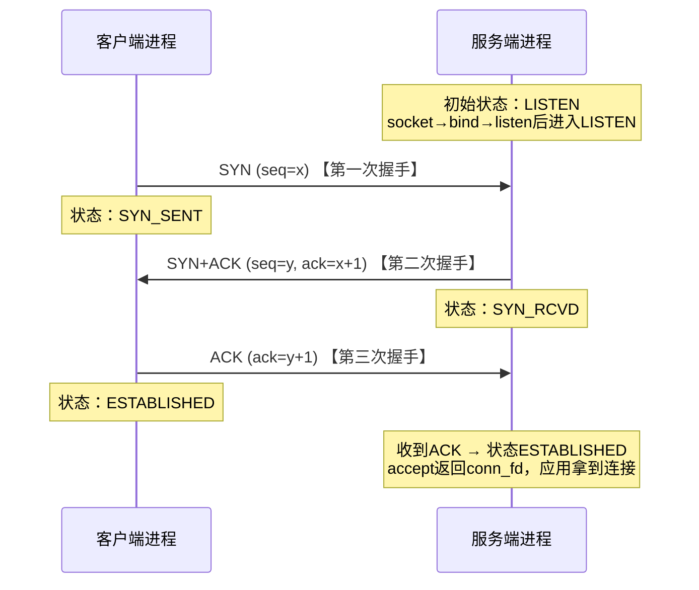
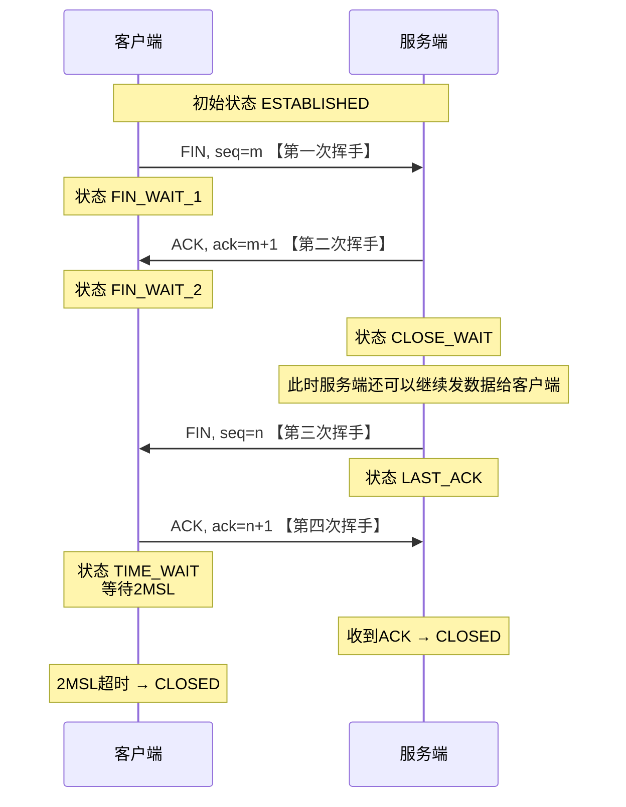

>本部分内容为个人整理，以面试和工作高频知识点为引扩展全貌，涵盖计算机软件工程方向几乎所有常用知识点，只要是在其中的都是重点内容，只是有的可能对面试意义不大，将根据面试进度推进不断补充或修改
- ⭐⭐⭐⭐⭐：极高频考点，必须掌握
- ⭐⭐⭐⭐：偶尔考到，尽量掌握
- ⭐⭐⭐：很少考到，看情况掌握
# 计算机组成原理 & 操作系统
- 新型PCIE架构的计算机的组成？
	- CPU、RAM、DDR5总线、PCIE总线、南桥、IO设备
- 计算机组成层次：⭐⭐⭐⭐⭐
	- 应用层-汇编层-操作系统层-硬件层
- linux上电启动过程？⭐⭐⭐⭐⭐
	- 上电
	- BIOS/UEFI 硬件自检
	- 引导加载程序 (bootloader，GRUB)加载到内存
	- 解压内核，内核初始化，临时文件系统
	- 挂载根文件系统
	- 祖先进程启动（systemd/init）
- Linux与Windows内核区别？
	- Linux：单体内核，模块式
	- Windows：混合内核，内核层、执行体、硬件层
- Linux内核组成？⭐⭐⭐⭐⭐
	- 进程管理
	- 内存管理
	- 设备驱动
	- 异常与中断
	- 文件系统
	- 网络系统
	- 内核线程
- 挂起、待机、休眠区别？⭐⭐⭐⭐⭐
	- 待机：一直在，内存和CPU都未断电
	- 挂起：存内存，内存未断电，CPU断电
	- 休眠：存硬盘，整机断电
- 字长指的是什么？⭐⭐⭐⭐
	- 机器字长为主，一般是64位
	- 地址字长：虚拟地址的大小
	- 机器字长：cpu一次能处理的大小（通用寄存器大小）
	- 总线字长：总线一次传输的数据量
	- 存储字长：每个存储单元能存储的大小
- 端序指的是什么？机器端序和网络端序？⭐⭐⭐⭐⭐
	- 小端：低字节低地址，机器端序
	- 大端：低字节高地址，网络端序
- 符号数有哪些表示方式？⭐⭐⭐⭐⭐
	- 原码：最高位符号位
	- 反码：正数不变，负数符号位以外取反
	- 补码：正数不变，负数反码+1
- 截断与溢出区别？⭐⭐⭐⭐
	- 截断：无符号超出表示范围
	- 溢出：有符号超出表示范围
- 内存溢出、泄露、越界的区别？⭐⭐⭐⭐⭐
	- 溢出：内存块不够用
	- 泄露：用了没释放
	- 越界：超出分配内存块
- 浮点数组成？
	- 符号：符号位
	- 尾数：小数，根据规格化非规格化，为1.xx或0.xxx
	- 阶码：尾数加权
- 结构体字节对齐问题？⭐⭐⭐⭐⭐
	- 结构体大小是最大对象倍数
	- 对象起始地址也是对象倍数
	- 所以最好从大到小声明
- 结构体与联合体区别？⭐⭐⭐⭐⭐
	- 结构体是单独空间且字节对齐
	- 联合体是共享空间
- CPU内有哪些重要寄存器？⭐⭐⭐⭐⭐
	- 被调用者寄存器
	- 调用者寄存器
	- 栈指针：RSP
	- 栈基址寄存器：RBP
	- 程序计数器：RIP
	- 计算结果标志：FLAGS
	- 代码段寄存器：CS（切内核态）
	- 页表基址寄存器CR3在MMU
- .O文件有哪些重要节？
	- .symtab符号表，记录程序所有符号（函数、全局变量）和逻辑地址
	- .rel.text/.rel.data重定位条目，记录对应段占位符引用的符号位置（符号表里）
	- 节头部表、段头部表
- 函数压栈流程（不考虑调用者被调用者寄存器）？⭐⭐⭐⭐⭐
	- 参数放寄存器，多余压栈
	- 返回地址压栈，RIP跳转
	- RBP压栈，RBP=RSP
	- RSP下移开辟空间
	- 局部变量压栈
	- RSP=RBP
	- RBP还原
	- 返回地址给RIP
- 什么叫缓冲区溢出？怎么预防？⭐⭐⭐⭐⭐
	- 数组向高区域增长，超过边界覆盖返回地址
	- 使用安全函数
	- 地址随机化
	- 金丝雀值
- 程序编译流程？⭐⭐⭐⭐⭐
	- 预处理(.cpp)-编译(.i)-汇编(.s)-链接(.o)-加载-运行
- 静态链接流程？
	- 节合并
	- 符号解析：符号和逻辑地址匹配，链接器给各个段分配虚拟地址（符号也就有了真正虚拟地址）
	- 重定位：根据重定位条目将占位符填充为符号虚拟地址
	- 收尾：合并段，丢弃.rel/.symtab
- 动态链接流程？动态无关代码流程？⭐⭐⭐⭐
	- 链接：
		- 节合并
		- 假符号解析：符号和逻辑地址匹配
		- 假重定位1：构建.plt表（代码段）和.got表（数据段），plt保存每个外部函数跳转到.got.plt，got保存外部变量
		- 假重定位2：构建.rel.dyn-.got和.rel.plt-.got.plt，类似.rel.text功能
		- 填写.dynamic：记录依赖的.so
	- 加载：
		- 程序和动态库映射到虚拟内存
		- 动态链接器获得控制权
		- 符号解析：链接器给各个段分配虚拟地址（符号也就有了真正虚拟地址）
		- 重定位：根据.rel.dyn和.rel.plt将占位符填充为符号虚拟地址（.rel.plt延迟绑定）
		- 交给_start入口执行
- 动态链接器查找so的顺序？⭐⭐⭐⭐⭐
	- -rpath=参数
	- 环境变量 `LD_LIBRARY_PATH`
	- 配置文件`/etc/ld.so.conf`
	- 默认目录`/lib`、`/usr/lib`
- 静态库动态库区别和优劣？⭐⭐⭐⭐⭐
	- 静态库：编译时加进去，无多余文件依赖，共享差，环境兼容好，更新需要重编译
	- 动态库：运行时或加载时才用，有多余文件，共享好，按需运行，环境兼容差
- CPU流水线流程⭐⭐⭐⭐⭐
	- 取指-译码-执行-访存-写回-更新
- CPU流水线冒险？怎么解决？⭐⭐⭐⭐⭐
	- 数据冒险（数据）：转发、暂停
	- 控制冒险（地址）：分支预测、暂停
	- 结构冒险（硬件）：加硬件、暂停
- CPU使用率与Load平均值区别？⭐⭐⭐⭐
	- CPU 使用率：百分比，描述 CPU 正在干活的时间占比
	- Load Average：数值，描述 CPU 上运行和就绪的进线程数量
- 缓存类型⭐⭐⭐⭐⭐
	- 组相联：s组e行
	- 直接映射：e=1
	- 全相联：s=1
- 缓存不命中类型⭐⭐⭐⭐⭐
	- 冷不命中：冷启动
	- 冲突不命中：抢同一个位置
	- 容量不命中：工作集太大
- 缓存替换策略：
	- Random
	- LRU
	- LFU
- CPU三级缓存机制：
	- L1、L2在同一CPU核心中是独占的，L3在外面是共享的
	- L1有独立的指令缓存和数据缓存，L2、L3没有
	- L1、L2还有专门的TLB缓存，L3没有，而是DDR5存储控制器代替
- RAM和ROM区别和应用？⭐⭐⭐⭐⭐
	- RAM：易失断电清零，SRAM做缓存，DRAM做主存
	- ROM：非易失断电不清零，EEPROM做BIOS，NAND FLASH做U盘
- 主存的结构
	- 内存控制器
	- 行缓冲区
	- 存储区
- 什么叫僵尸进程？孤儿进程？守护进程？祖先进程？⭐⭐⭐⭐⭐
	- 祖先进程：init/systemd(PID=1)
	- 僵尸进程：子进程结束未回收，退出状态存放在PCB块
	- 孤儿进程：父进程退出子进程还在，被祖先收养
	- 守护进程：后台长期运行的服务
- 异常类型：⭐⭐⭐⭐⭐
	- 同步：触发源在CPU内；异步：触发源在CPU外
	- trap（同步）
	- 异常：故障、终止（同步）
	- 中断（异步）
- 异常和信号返回位置区别？⭐⭐⭐⭐⭐
	- trap：下一条指令
	- 故障：本指令
	- 终止：直接杀死进程
	- 中断（异步）：下一条指令
	- 信号（异步）：回到被信号打断的指令执行
- 程序局部性原理：⭐⭐⭐⭐⭐
	- 空间：接近的数据更有可能访问
	- 时间：最近访问的数据以后更有可能访问
- 中断、信号可以睡眠、进程切换或嵌套吗？⭐⭐⭐⭐⭐
	- 中断：不能睡眠、切换，可以嵌套，工程上关中断避免嵌套
	- 信号：可以睡眠、切换、嵌套，工程上避免睡眠、切换、嵌套
- 上下文切换情景：⭐⭐⭐⭐
	- trap-模式切换
	- 故障-缺页异常
	- 中断-IO中断
- 进程控制块PCB（task_struct）内容：⭐⭐⭐⭐⭐
	- id：pid、父进程指针
	- 虚拟地址和页表：mm_struct
	- fd表：files_struct
	- 信号：线程独占：blocked、pending；线程共享：信号动作表、共享pending
	- 调度：状态、优先级、CFS参数
	- 内核栈地址
	- 资源限制
	- task链表头
- 虚拟地址空间（mm_struct）内容：⭐⭐⭐
	- 数据结构：双向链表、红黑树
	- 页表基址
	- 段边界
	- 引用计数
	- 锁
- 虚拟区间（vm_area_struct）内容：
	- 地址范围
	- 数据结构：双向链表、红黑树
	- 归属
	- mmap文件映射
	- 权限
	- 匿名映射反向映射
- 进程虚拟地址空间结构：⭐⭐⭐⭐⭐
	- 内核空间：
		- kmap_atomic临时映射
		- kmap固定映射
		- vmalloc虚拟映射
		- kmalloc直接映射（代码段.text/.rodata、数据段.data/.bss、内核栈stack）
	- stack向下：局部变量、函数帧
	- shared library：.so映射区、mmap
	- heap向上：malloc/new
	- .bss：未初始化全局、静态变量
	- .data：初始化全局、静态变量
	- .init：初始化代码
	- .rodata：只读数据（常量、字面值、虚函数表）
	- .text：代码
- 进程上下文包括哪些？⭐⭐⭐⭐⭐
	- 本质就是寄存器+PCB
	- 硬件：寄存器（通用、RIP、RBP、RSP、FLAGS）
	- 内核：task_struct内容（PID、fd表、信号、调度、页表）
	- 用户：页表mm_struct
- 进程上下文与中断上下文区别？⭐⭐⭐
	- 进程上下文：属于具体进程，
	- 中断上下文：不属于任何进程，禁止sleep，不能处理信号
- fork流程⭐⭐⭐⭐⭐
	- 复制task_struct，新建内核栈，寄存器清空
	- 复制资源：页表（写时复制）、fd表、信号（动作表和blocked）
	- 分配PID加入链表
	- 加入就绪队列等待调度
- fork后子进程与父进程哪些共享哪些独占？⭐⭐⭐⭐⭐
	- 共享：代码段、fd表、信号（动作表和blocked）、环境变量
	- 独占：内核栈、寄存器、pid
	- 写时复制：可写内存页
	- 注意子进程只有一个线程，fork后父进程返回子进程pid，子进程返回0
- execve流程：⭐⭐⭐⭐⭐
	- 页表更新：删除旧mm_struct，新建新mm_struct，加载.o段
	- 信号重置：自定义信号重置为SIG_DFL，SIG_IGN保持，blocked保留，pending清零
	- 入口执行：执行入口函数
- fork与exec的区别？⭐⭐⭐⭐
	- fork：创建子进程
	- exec：替换地址空间，加载新程序，同一进程
- fork与vfork的区别？⭐⭐⭐⭐
	- fork：写时复制，父子独立虚拟地址空间
	- vfork：无写时复制，子共享父地址空间，父进程阻塞
- wait与waitpid区别？
	- wait是waitpid特例，waitpid支持子进程组、非阻塞
- 进程退出函数是什么？
	- exit
- 虚拟地址寻址字长多少？⭐⭐⭐
	- 硬件是64位，但实际使用48位（9+9+9+9+12）
	- 32位3+1GB，64位128TB+128TB
- 进程状态转移过程？⭐⭐⭐⭐⭐
	- 新建（fork）
	- 就绪（时间到期、高优先抢占）：就绪队列
	- 运行
	- 阻塞（IO事件、sleep、其他阻塞事件）：阻塞队列
	- 终止（崩溃、退出、收到kill信号）
- 模式切换过程（用户态-内核态）？⭐⭐⭐⭐⭐
	- 触发源：三类异常发生
	- 异常号放到寄存器，执行syscall
	- 通用寄存器入内核栈pt_regs，修改特权位ring3-ring0进入内核态，用户栈切换为内核栈，根据异常向量表跳转内核处理函数
	- 处理完成后，pt_regs恢复，修改特权位回ring3，内核栈切回用户栈，返回
	- 特别：trap不走异常向量表流程，直接从MSR寄存器入口进入syscall，根据里面的系统调用表跳转对应函数处理
- 内核态用户态区别？⭐⭐⭐⭐
	- 内核态：高权限，ring0
	- 用户态：低权限，ring3
- 异常向量表（中断向量表）的结构：
	- 0-31号：异常和trap（trap不用）
	- >=32号：中断
	- 系统调用表是另外一个表
- 进程切换过程？⭐⭐⭐⭐⭐
	- 触发源：阻塞、时间到、优先级抢占
	- 模式切换
	- 保存当前进程上下文
	- 刷新TLB
	- 调度器选择下一个进程
	- 切换下一个进程上下文
	- 模式切换
- 进程调度策略：
	- 非抢占：FIFO、优先级
	- 抢占：RR、优先级RR
	- 多处理器：工作迁移
- Linux进程调度策略：⭐⭐⭐⭐⭐
	- SCHED_FIFO：先来先服务
	- SCHED_RR：时间片轮转
	- SCHED_OTHER（CFS）：公平调度
	- SCHED_BATCH：nice值自动增长
	- SCHED_IDLE：空闲才运行
- CFS进程调度过程？⭐⭐⭐⭐⭐
	- 就绪队列红黑树，根节点vruntime最小
	- vruntime是进程已获得虚拟时间，越小越优先
	- 权重nice值，越小越优先
	- 任务时间是按照加权分配的，总时间一定
	- 负载差距过大会工作迁移，vruntime重新校准
- 地址转换过程？⭐⭐⭐⭐⭐
	- 虚拟地址=VPN+偏移量
	- VPN查页表得到PPN（多级页表、TLB缓存）
	- 物理地址=PPN+偏移量，寻址（Cache缓存）
- 块管理？物理内存管理？磁盘管理？堆管理？⭐⭐⭐⭐
	- 数据块：前块大小、前块空闲标志
	- 方式：空闲列表、空闲位图、空闲链表
	- 空闲链表（双向链表）：普通链表、分离链表（不同大小块）、伙伴系统（2幂次）
	- 入链策略：哈希表头插、地址相连插入
	- 出链策略：首次适配、下次适配、最佳适配、最坏适配
- 物理内存耗尽情形？⭐⭐⭐⭐⭐
	- 页面交换swap
	- 内存回收，进程会阻塞
	- OOM触发直接杀进程
- 缺页异常过程？⭐⭐⭐⭐⭐
	- 虚拟页有效位：已映射1、未映射0、被换出0
	- 有效位为0触发
	- 查找VMA判断虚拟地址是否合法，不合法直接终止
	- PTE有无swap信息？
		- 有，被换出，从swap换回，填充物理地址，有效位=1，重新执行缺页的命令
		- 无，未映射，内核分配物理地址，有效位=1，重新执行缺页的命令
- VMA的文件对象与匿名对象？⭐⭐⭐⭐
	- 文件对象：磁盘中持久，.o文件、.so动态库、文件mmap、信号量、管道、本地域socket
		- 私有映射MAP_PRIVATE：读共享，写写时复制
		- 共享映射MAP_SHARED：读写共享
	- 匿名对象：内存中临时，栈、堆、匿名mmap、信号量、管道、本地域socket
	- 匿名对象在空间不足时会换到swap分区
	- 注意.o文件的.bss段是匿名映射！
- 段页表？反向页表？
	- 段页表：先分段再分页
	- 反向页表：根据物理地址匹配逻辑地址，需要遍历
- malloc过程？⭐⭐⭐⭐⭐
	- 在缓存的空闲链表bin里查找有没有可用的
		- fastbin、unsorted bin、small bins、large bins
		- Top chunk
	- 小的用brk扩展
	- 大的用mmap匿名映射
	- 惰性分配，第一次使用触发缺页异常分配物理地址
- free过程？⭐⭐⭐⭐⭐
	- 小的标记为空闲块，缓存到空闲链表bin
	- 大量空闲用brk收缩
	- 大的直接munmap回收
- mmap过程？⭐⭐⭐⭐⭐
	- mm_struct中找一块空闲区间，建立VMA（PTE全是0），绑定动作集
		- 文件：绑定inode和vm_ops，缺页磁盘读到物理页（根据私有还是共享不一样）
		- 匿名：匿名缺页处理函数，缺页直接分配物理页，压力大会换到swap分区中
	- 程序加载 ELF、so 库本质就是 loader 调用 mmap 做文件映射！
- munmap过程？
	- 删除VMA，释放物理页
	- 清除PTE，刷新TLB
- 页交换策略？⭐⭐⭐⭐⭐
	- FIFO
	- LRU
	- LFU
	- Clock：时间轮，类似环形缓冲区
	- 抖动问题：频繁换入换出，增加硬件解决
- 进程线程区别⭐⭐⭐⭐⭐
	- 进程是资源分配最小单位，父子关系
	- 线程是指令执行最小单位，对等关系
- 协程线程区别⭐⭐⭐⭐⭐
	- 线程：内核调度，切换开销大
	- 协程：用户调度，切换开销小
- 线程的独立资源和共享资源⭐⭐⭐⭐⭐
	- 独立：栈、内核栈、寄存器、信号blocked、TLS变量、调度相关、errno
	- 共享：虚拟地址空间（除栈外）、fd表、页表、信号处理函数等大部分资源
- 普通线程和分离线程（detached）？
	- 普通线程：资源不会自动释放
	- 分离线程：资源自动回收
- 线程崩溃会导致进程崩溃吗？
	- 会，因为信号是发给进程共享pending
- 线程切换过程？⭐⭐⭐⭐
	- 跟进程一样，不换页表
- clone过程？⭐⭐⭐⭐
	- fork内部就是调用了clone
	- 可以根据flags控制共享的资源
- 解释一下并发、并行、互斥、同步、阻塞、共享、竞争、临界区？⭐⭐⭐⭐⭐
	- 并发：假装同时执行
	- 并行：真的同时执行
	- 共享：共用的资源
	- 竞争：同一时刻时序不同结果不同
	- 互斥：同一时刻只能相同结果
	- 同步：同一时刻执行顺序确定
	- 临界区：导致竞争的代码
	- 阻塞：程序暂停等待资源
- 同步一定阻塞吗？阻塞一定同步吗？⭐⭐⭐
	- 两个独立概念，都不一定啊
- 介绍生产者消费者模型？⭐⭐⭐⭐
	- 生产者生产数据放入队列，消费者从队列消费数据。
	- 队列做互斥和同步保护，一般使用锁+条件变量（2个）
	- 一般用队空队满的谓词条件变量（CAS）防止虚假唤醒
- 什么叫无锁编程？哪些无锁队列？无锁队列会导致什么问题？
	- 不使用导致阻塞的锁，自旋是允许的
	- MS队列：多生产者多消费者，单向链表+头尾指针，有ABA问题，需要内存回收方案，C++20已经支持atomic智能指针
	- ringbuffer：单生产者单消费者，没有ABA，但有伪共享问题
- 为什么要用原子变量？什么叫内存序？⭐⭐⭐⭐⭐
	- CPU乱序执行会导致多线程出现诡异BUG，内存序保证共享内存的指令顺序
	- 原子变量：保证操作原子性，保障内存序，自旋
	- 内存序：
		- relaxed：无约束
		- acquire：后面的不能排到本读前面
		- release：前面的不能排到本写后面
		- seq_cst：顺序完全一致
	- 工程使用一般是读acquire，写release
- 线程安全函数是什么？异步信号安全函数是什么？⭐⭐⭐
	- 线程安全说明多个线程可以同时调用无同步问题
	- 弱线程安全：有锁、原子量
	- 可重入：无共享变量，引用传参也是非共享
	- 异步信号安全函数就是可重入函数
- 幂等是什么？⭐⭐⭐⭐⭐
	- 同一个请求重复多次结果和第一次执行完全一样
- 读者写者模型和读写锁是什么？
	- 读者共享读，写者单独写
	- 读者优先
	- 写者优先：写阻止读
	- 公平排队：一起抢锁，解决饥饿
- 保证互斥或者同步的设施有哪些？⭐⭐⭐⭐⭐
	- 有锁编程：
		- 锁：互斥锁（死锁）、自旋锁（内核自旋、TAS、CAS、活锁、禁止递归sleep）、读写锁、递归锁
		- 条件变量：需要互斥锁保护，条件覆盖问题（broadcast广播）、信号丢失问题（全局变量记录通知次数或信号量）
		- 信号量：P-1，V+1，引用计数，二元（1，模拟互斥锁）、计数（0，模拟条件变量），有匿名命名
	- 无锁编程：
		- 原子操作：atomic、内存序
		- 屏障：barrier（可复用）
	- 信号量支持跨线程操作，锁只能当前线程解锁加锁！
	- 互斥：应用循环忙等、关中断、锁、信号量、原子操作
	- 同步：条件变量、信号量、原子操作、屏障
- 进程间通信IPC有哪些方法？线程间呢？⭐⭐⭐⭐⭐
	- 管道：半双工，pipe0读1写，自带互斥同步自动阻塞，有匿名命名
	- 本地域socket：半双工，sockaddr_un，全双工socketpair，有匿名命名
	- 共享内存：mmap、shmget，有匿名命名
	- 信号：内核或kill发送，动作表actions（默认、忽略、自定义），pending、blocked、shared_pendings、signation、
	- 消息队列：msgsnd，很少用
	- 线程间：共享变量、共享内存
- 自旋锁与信号量可以睡眠吗？⭐⭐⭐⭐
	- 自旋锁：严禁睡眠、递归
	- 信号量：可以睡眠
- 死锁的成因？解决？⭐⭐⭐⭐⭐
	- 两个线程持有锁顺序相反互相占有
	- 四个因素（不背）：不可抢占、互斥资源、占有资源、互相等待
	- 解决：同样顺序锁打包、设置超时时间
- 并行编程是什么？
	- 利用多核将线程计算结果保存在全局数组中
- 多线程下信号是怎么处理的？
	- 进程收到信号，如果信号被当前线程掩码阻塞，内核会把信号递交给本进程内某个没有阻塞该信号的线程
	- 信号处理函数是共享的哦
	- 推荐专门线程用sigwait处理信号，不需要信号处理函数了
- 信号接收流程？⭐⭐⭐⭐⭐
	- 接收信号，公有私有pending置位，只留一次
	- 根据blocked和本信号阻塞其他信号
	- 扫描pending，未blocked就按顺序执行动作表里的动作，清除pending
- 信号处理程序线程安全吗？怎么保证线程安全？⭐⭐⭐⭐⭐
	- 不安全
	- 逻辑简单
	- 只用信号安全函数
	- 临界区屏蔽所有信号
	- 原子变量
- IO设备类型？⭐⭐⭐⭐⭐
	- 字符设备：鼠标、键盘、串口
	- 块设备：硬盘、U盘
	- IO控制器：控制、数据、状态
- IO通信方式？⭐⭐⭐⭐⭐
	- CPU轮询
	- 中断（字符设备）：CPU参与数据拷贝
	- DMA（块设备）：CPU不参与数据拷贝
	- IO独立通道：可以看作独立负责IO的CPU
- DMA缓冲不一致性？⭐⭐⭐⭐⭐
	- CPU 走 Cache，DMA 直连物理内存；两者对同一块内存看到的数据副本不一样
	- CPU 写 → DMA 读：DMA 启动前，**Clean（刷回）Cache**
	- DMA 完成后、CPU 读取前，**Invalidate（失效）Cache 行**
- IO库类型？
	- read：UNIX IO，适合网络
	- fread：标准库IO，适合本地文件
	- rio_readn：RIO，适合网络
- 中断发生流程？DMA有何区别？⭐⭐⭐⭐⭐
	- 设备把数据放入数据寄存器，向中断控制器发送IRQ
	- CPU完成当前指令，关中断，模式切换进入内核态，进入中断处理程序
		- 上半部：数据拷贝，清中断
		- 下半部：耗时业务
	- 中断返回iret，模式切换回用户态继续执行
	- DMA只有一个区别就是在第一步就完成了数据拷贝，上半部只做DMA传输完成校验
- 磁盘读取时间由哪些组成？⭐⭐⭐⭐
	- 寻道时间+旋转时间+读取时间
- 磁盘请求调度算法有哪些？
	- SSTF：最近先服务
	- FIFO：
	- SCAN：上下来回
	- C‑SCAN：上下来回，到尾从头来
	- SPTF：计算最短定位时间
- RAID类型？⭐⭐⭐⭐⭐
	- RAID0：条带化分割
	- RAID1：镜像条带化
	- RAID4：多个奇偶校验盘
	- RAID5（常用）：旋转奇偶校验
- 文件类型？⭐⭐⭐
	- 文件
	- 目录项：文件名+inode号列表
	- socket
- 文件系统作用？
	- 向上为用户层提供统一的read/write等系统调用，向下操作设备驱动程序管理块设备
	- Linux将所有IO设备都抽象成文件
	- 权限保护
	- 方便元数据管理
- 文件描述符fd是什么？
	- 是进程fd表数组的下标，内含指针指向内核struct file
- 文件系统索引的三层结构？⭐⭐⭐⭐⭐
	- 进程fd表：指针指向struct file
	- struct file：offest、打开模式、引用计数
	- inode：磁盘上，内存中v-inode，元数据（时间、权限、磁盘块指针、硬链接计数）
- 文件系统ext4磁盘布局？
	- 超级块
	- 组描述符表（以下结构位置）
	- inode表
	- 块位图
	- 位图
	- 寻址：12直接块指针+4级间接块指针
- 预读失效与缓存污染?⭐⭐⭐⭐⭐
	- 预读失效：内核预读的页没用到，解决：不要随机IO，posix_fadvise
	- 缓存污染：一次性读大量冷数据把热数据挤出去，解决：冷数据用完即丢，posix_fadvise
- 怎么提高文件系统性能？
	- 批量IO
	- posix_fadvise：解决预读失效、缓存污染
	- 绕过页缓存
	- 减少元数据操作
	- IO多路复用
	- 内核参数调优
- 硬链接与软链接区别？⭐⭐⭐⭐⭐
	- 硬链接：inode引用计数+1，不能跨系统，unlink直到引用计数为0和进程结束使用才删除inode
	- 软链接：复制inode，可以跨系统
- 逻辑块真正落盘方式？
	- 连续分配：Kafka
	- 隐式链接
	- 显式链接：fat32
	- inode：直接+间接块指针
- 怎么保证崩溃一致性？⭐⭐⭐
	- 日志文件系统
	- IO屏障
	- fsync
- 日志系统会发生哪些问题？⭐⭐⭐⭐⭐
	- 事务日志与数据日志（MySQL的RDB与AOF）
	- 异步日志：单开日志线程处理
	- 日志乱序：时间戳
	- 日志丢失：强制落盘、定时落盘
	- 缓冲区满（瞬时背压）：丢弃低级别、扩大容量、增加消费者人数
	- 丢弃策略：丢弃最老的、丢弃最长的之类的
- 日志落盘策略有哪些？⭐⭐⭐⭐⭐
	- 定时落盘
	- 缓冲区满落盘
	- 程序退出强制落盘
	- 高优先级直接落盘
- 日志滚动策略有哪些？⭐⭐⭐⭐⭐
	- 根据日期滚动
	- 根据大小滚动
- 定时器类型？⭐⭐⭐⭐
	- 升序链表
	- 时间堆：muduo
	- 时间轮：Kafka
- 定时器怎么触发？⭐⭐⭐
	- alarm：一次性定时
	- setitimer：循环定时
	- socket超时、epoll超时自动触发
	- 通过SIGALARM信号通知
	- timerfd可以将定时器封装成fd放入epoll监听
- 有界队列与无界队列区别？
	- 有界队列：需要出队策略
	- 无界队列：会内存暴涨
- 超级服务器什么意思？
	- 监听多个服务端口，按需启动服务
- 拷贝fd使用什么函数？
	- dup
- 分散读集中写是什么意思？零拷贝是什么意思？⭐⭐⭐⭐⭐
	- 分散读集中写：readv，数据读到多个缓冲区，从多个缓冲区合并发送
	- 零拷贝：没有用户缓冲区的拷贝
		- sendfile：文件-socket，把数据从磁盘拷贝到内核缓冲区，把指针传给socket，直接从内核缓冲区发送数据
		- splice：两个fd的内核缓冲区之间转移数据
# 计算机网络
- 网络拓扑类型
	- 总线型、星型、环形、树形、网状
- mss与mtu区别？⭐⭐⭐⭐⭐
	- mtu：链路层最大帧长（不含头），1500
	- mss：tcp层最大包长（不含头），1460
- 怎么喊每个协议的消息体？
	- 以太帧、ip包、tcp段、udp报
- 什么叫带宽、吞吐量、QPS、丢包率？⭐⭐⭐⭐
	- 带宽：链路物理上限
	- 吞吐量：链路实际传输速度
	- QPS：每秒处理请求数
	- 丢包率：ip丢包数/总包数
- 网络的5层模型和各层功能？⭐⭐⭐⭐⭐
	- 应用层（会话层、表示层、应用层）-传输层-网络层-数据链路层-物理层
	- 物理层：物理传输、信号、物理接口，光纤
	- 数据链路层：物理寻址、CRC校验、信道共享，MAC、以太网、VLAN、WIFI
	- 网络层：逻辑寻址、路由选择、数据分片，IP、ICMP、ARP
	- 传输层：端到端通信、可靠传输（流量控制、拥塞控制、差错恢复、校验），TCP、UDP
	- 应用层：业务服务，HTTP、DNS、FTP
- 互联网的层级：
	- 内网-接入网-城域网-骨干网，外部互联网只有3级模型
	- ix：顶级机房
	- isp：运营商
	- cdn：p2p就近缓存
- 网络设备有哪些？工作在哪一层？⭐⭐⭐⭐⭐
	- 网卡：数据链路层，混杂模式才能看到其他包
	- 集线器：物理层，半双工
	- 交换机：数据链路层，全双工，有MAC表，保存MAC与端口映射
	- 路由器：网络层，全双工，有包过滤、路由表、NAT转换等功能，一般内置交换机
	- 防火墙：传输层
	- 网关：应用层
	- 服务器：应用层
- 传输模式有哪些？⭐⭐⭐⭐⭐
	- 单工：一边发一边收
	- 半双工：不能同时收发
	- 全双工：无限制
- 信道复用有哪些？
	- 静态：频分、时分、统计时分、波分、码分
	- 动态：CSMA载波监听、轮询、ALOHA
- 校验方法有哪些？
	- 校验：奇偶校验、CRC校验
	- 纠错：海明码
- PPPoE是什么？
	- 点对点协议PPP封装在以太网帧里，不需要MAC地址，LCP协商链路参数，NCP分配IP地址
- CSMA/CD是什么？⭐⭐⭐
	- 半双工总线才需要
	- 先听总线空闲才发
	- 持续监听冲突停发，阻塞，指数退避
	- 重试一定时间如果还失败就丢弃
- MAC帧格式？

- VLAN是什么？怎么实现？
	- 虚拟局域网，分割广播域，不同VLAN间通信需要路由了
	- 实现：以太网帧插入VLAN tag，端口分成VLAN内的普通端口（Access）和对外端口（Trunk）
	- 设备：单臂路由器、三层交换机
- ARP协议内容与寻址？⭐⭐⭐⭐
	- 从IP获得MAC，有ARP表，可动态或静态配置
	- 寻址：查询本地ARP表，没有就广播，获得就更新，对端也同时更新
	- arp攻击：中间人攻击
- IP地址类型？⭐⭐⭐⭐⭐
	- IPV4：点分10进制，网络位+主机位/网络位数，或子网掩码（网络位数个1），ABC类（8/16/24），
	- IPV6：冒分16进制，前导零压缩，没有广播全是组播，
	- 主机位全0是网络地址，全1是广播地址
	- 内网IP：A（10）、B（172.16）、C（192.168）
	- 特殊IP：127.0.0.0回环地址、0.0.0.0本机所有网卡地址
	- NAT地址转换：内网转外网，包含IP和端口，内网池和外网池静态动态绑定，端口转换（常用，只需要一个外网IP）
- IP协议的特性？IP协议包格式？⭐⭐⭐⭐⭐
	- 不可靠、无连接、可分片
	- 包头20B
	- 分片：标识+标志位
	- 路由：TTL
	- 校验和：只校验头

- IP的PMTU探测怎么实现？⭐⭐⭐⭐⭐
	- 发送数据标志位DF置1，如果太大了，返回ICMP消息提示过大，重新调整大小
	- PMTU黑洞：ICMP消息被防火墙拦住了
- IP分片怎么实现？⭐⭐⭐⭐⭐
	-  少分片
	- 标识表示是不是同个包
	- 标志位表示是中间包还是结尾包
	- 片偏移方便拼装
	- 如果错误等待上层重传
- ICMP协议内容与功能？⭐⭐⭐⭐
	- 差错报告，支持PMTU、重定向、不可达、超时、网络探测（ping）
- 路由表什么结构？怎么更新？
	- 路由类型：直连、静态、动态
	- 路由的目标IP是不变的奥，除非NAT转换
	- 结构：目标IP、路由协议（OSPF、RIP、BGP）、距离、度量、下一跳、端口
	- 先比距离再比度量，ICMP重定向也可更新
- 复用分用什么意思？伪首部什么意思？
	- 复用分用：多个进程的数据统一给传输层打包发送
	- 伪首部：在TCP层把源目的IP放到payload中校验
- UDP和TCP的特点和区别？⭐⭐⭐⭐⭐
	- UDP：不可靠、无连接、低时延、全双工
	- TCP：可靠、连接、高时延、全双工
- UDP报文格式（头8B）？

- TCP报文格式（头20B）？⭐⭐⭐⭐⭐
	- 序列号：每一条TCP连接独立一个序号，发送端和接收端分开，ACK不推进序列号
	- 标识位：ACK、SYN、FIN、RST（复位）、URG（带外数据）
	- 流量控制：接收窗口rwnd
	- 带外数据：紧急指针
	- 选项：窗口扩大因子、MSS

- 为什么TCP3次握手却要4次挥手？⭐⭐⭐⭐⭐
	- 因为SYN可以与ACK合并，但FIN不能与ACK合并，因为ACK完后业务数据可能没发完，发完才FIN
- TCP三次握手全流程（connect+accept）⭐⭐⭐⭐⭐

- TCP四次挥手全流程（close，服务端和客户端都可以）⭐⭐⭐⭐⭐

- TCP通信半连接什么意思？⭐⭐⭐⭐⭐
	- 3次握手本端进入SYN_RCVD状态未收到ACK，放到listen管理的半连接syn队列
	- syn洪泛攻击：虚假IP发送syn故意不回打满半连接队列，防御：不保存半连接，信息编码后作为SYN+ACK的seq直接发送
- TCP通信半关闭什么意思？⭐⭐⭐⭐⭐
	- 半关闭：4次挥手本端进入CLOSE_WAIT状态，还可以send剩余数据，必须本端close才真正关闭
- TIME_WAIT是什么？为什么要这么做？会导致什么影响？怎么解决？⭐⭐⭐⭐⭐
	- 4次握手完后需要等一会儿（2msl/2min）
	- 原因：
		- 确保ACK到达
		- 等待信道残余报文消失
	- 问题：占用端口
	- 解决：socket设置
- 带外数据怎么接收的？怎么识别到有带外数据？
	- 发送方URG置位，紧急指针指向带外数据下一个字节
	- 根据socket设置，带外数据可能在带外缓存或混在缓冲区中
	- IO多路复用异常事件或SIGURG信号判断带外数据到来，读取指针前一个字节
- TCP什么时候发送复位消息？⭐⭐⭐⭐⭐
	- 访问不存在端口（或TIME_WAIT）
	- 异常连接终止
	- 半连接恢复
- TCP怎么保证可靠传输的？⭐⭐⭐⭐⭐
	- seq保证顺序，支持乱序重排
	- 校验和：RFC1071算法
	- 差错重传：超时定时器翻倍后退，实在不行就丢弃
		- IP分包错误
		- 超时重传：计时器到期（根据RTT计算）
		- 快速重传：3次冗余ACK
	- 流量控制：
		- 接收方在ACK 报文里携带 rwnd，告诉发送方只能发多少字节
		- 窗口探测（rwnd=0后定时发送1字节问问好了没）
	- 拥塞控制：
		- 本地维护一个cwnd
		- 慢启动：从1MSS开始，每收到1ACK+1MSS，指数增长直到ssthresh
		- 拥塞避免：只+1MSS，线性增长
			- 超时重传：ssthresh减半，从1MSS开始
			- 快速重传：ssthresh减半，从ssthresh开始
			- 快速恢复：收到ACK，线性增加
	- 最终发送的数据大小由rwnd和cwnd共同决定
- TCP粘包怎么解决？⭐⭐⭐⭐⭐
	- 长度前缀
	- 特殊分隔符
- UDP怎么实现可靠传输？
	- 停等：发一个包，等 ACK
	- 滑动窗口ARQ：发一堆包，收到ACK向前滑动窗口，支持选择性重传
	- KCP就是可靠UDP实现
- DNS协议内容与寻址（UDP）？⭐⭐⭐⭐⭐
	- DNS就是寻址域名与IP的映射，先找本地HOSTS文件，再问本地域名服务器然后往上遍历
	- 查找方式有两种：
		- 递归：向上遍历到根，根帮你查
		- 迭代：域名服务器只告诉你下个节点地址，自己一个个问
- DNS的记录类型？⭐⭐⭐⭐
	- A、AAAA：IP
	- CNAME：别名
	- PTR：反查
	- MX：邮件
- DHCP协议内容（UDP）？⭐⭐⭐
	- 动态分配IP的协议，自动分配、动态分配（租期）、静态分配（绑定MAC）
	- 客户端广播申请IP
	- 服务器返回带租期的IP
	- 客户端广播选择的IP（第一个接收的）
	- 服务器返回确认信息
	- 快到期客户端向服务器申请续租
- email相关协议内容？
	- smtp发送，pop3接收
- 什么叫隧道什么叫代理？⭐⭐⭐⭐
	- 代理：正向（VPN）、反向（安全）、透明（监控）
	- 隧道：将原数据用特定协议封装，加上协议包头传输
- HTTP协议（TCP）报文结构？⭐⭐⭐⭐⭐
	- 请求报文：
		- 请求行：方法、路径、HTTP版本
		- 请求头：元数据
		- 空
		- 请求体：json、表单
	- 响应报文：
		- 响应行：HTTP版本、状态码、描述
		- 响应头：元数据
		- 空
		- 响应体
- 常用元数据？⭐⭐⭐⭐⭐
	- Content‑Encoding：压缩编码
	- Content-Type：支持MIME类型
	- Transfer‑Encoding：分块传输
	- Range：范围传输
	- Multipart：多对象多头部
	- Connection：长连接keepalive
	- Authorization：认证
- 请求方法类型？⭐⭐⭐⭐⭐
	- GET：获取
	- POST：发送
	- PUT：全量替换 / 更新资源，PUT和DELETE有安全性问题，只有Restful标准应用才开放使用
	- DELETE：删除指定资源
	- PATCH：局部替换
	- HEAD：同 GET，仅返回响应头
	- OPTIONS：查询服务器支持的请求方法
	- TRACE：链路调试，Max-Forwards字段说明中转跳数
	- CONNECT：代理转发 HTTPS 流量，会使用SSL和TLS把通信内容加密
- 状态码类型？⭐⭐⭐⭐⭐
	- 1：信息
	- 2：成功
	- 3：重定向
	- 4：客户端错误
	- 5：服务端错误
- cookie和session的区别？⭐⭐⭐⭐⭐
	- cookie是服务器下发给客户端浏览器的一小段状态数据保存状态信息（HTTP无状态），服务器set-cookie，客户端cookie
	- session是服务器的会话数据对应id，可以通过cookie发送给用户
- 对称加密与非对称加密？公钥与私钥？数字证书？⭐⭐⭐⭐
	- 对称加密：加解密一个密钥，AES
	- 非对称加密：加密公钥，解密私钥，RSA
	- 数字证书：域名+服务器公钥被CA公钥加密
- 信任链与自签名证书？
	- 自签名证书：自己给自己公钥签名
	- 信任链：浏览器自带CA->中间CA证书->网站业务证书->网站公钥可信
- HTTPS是怎么工作的？⭐⭐⭐⭐⭐
	- HTTPS是HTTP套在TLS上面形成的，不是独立协议
	- TCP握手
	- TLS握手：服务器发公钥，客户端用CA验证公钥
	- 交换密钥：客户端用公钥加密对称密钥发给服务器，双方互相通知开始加密传输
	- 加密传输：用对称密钥加密传输

- HTTP2与HTTP1的区别？⭐⭐⭐⭐⭐
	- 头部压缩
	- 支持多路复用（不同stream id分割开）
	- 二进制传输
	- 服务器可以主动推送
# 并发编程 & 网络编程
- 并发编程的三种实现：⭐⭐⭐⭐⭐
	- 多线程、事件、多进程
- 多进程、多线程的区别与使用场景？⭐⭐⭐⭐⭐
	- 多进程：资源隔离开销大，任务之间强隔离强可靠性要求，CPU密集型业务
	- 多线程：资源共享开销小，大量短任务切换，IO密集型业务
- 事件源类型：⭐⭐⭐⭐⭐
	- socket
	- 信号（通过管道、signalfd）
	- 定时器（timerfd）
- 服务器模型：
	- cs
	- p2p
	- 分层设计
- 服务器架构？⭐⭐⭐
	- 防火墙
	- 代理服务器（负载均衡、保护）
	- 后端服务器
	- 缓存服务器
	- 数据服务器
- listen socket与connect socket的区别⭐⭐⭐⭐⭐
	- listen socket：listen监听连接，负责3次握手，维护半连接队列syn和全连接队列accept，握手成功后将半连接队列的连接放入全连接队列
	- connect socket：accept返回的连接，从全连接队列取出，负责业务读写
- socket常用配置setsockopt？⭐⭐⭐
	- 端口复用
	- 修改缓冲区大小
	- 保活
	- 超时时间
	- Nagle算法
- socket连接全流程？⭐⭐⭐⭐⭐
	- 服务端：socket、bind、listen、accept、recv/send、recvfrom/sendto、close
	- 客户端：socket、connect、recv/send、recvfrom/sendto、close
	- 对端正常关闭连接发送FIN，recv会收到0
- 调用 send 返回成功说明数据发出去了吗？⭐⭐⭐⭐⭐
	- 仅代表数据成功拷贝进内核 TCP 发送缓冲区
	- 通过超时重传+ACK机制保证收发成功
	- 如果需要拿到这个收到信号，需要自己在应用层做实现（收到ACK时）
- 常见并发问题？⭐⭐⭐
	- 竞争
	- 饥饿
	- 死锁
	- 活锁
	- ABA
	- 虚假唤醒
	- 指令重排
	- 优先级反转
	- 锁粒度
	- 伪共享
- 网络编程怎么提高性能？⭐⭐⭐
	- 非阻塞fd
	- 零拷贝（sendfile）
	- 分散读集中写（readv）
	- 池化技术
	- 锁粒度设计
	- 超级服务器
- 网络IO模型有哪些？⭐⭐⭐⭐⭐
	- 都是两阶段，第一阶段数据收发，第二阶段数据拷贝
	- 阻塞IO（全阻塞）
	- 非阻塞IO（业务轮询）
	- IO多路复用（第一阶段IO多路复用）
	- 信号驱动IO（第一阶段SIGIO信号处理程序）
	- 异步IO（全阶段异步，第二阶段返回信号处理程序）
- IO多路复用有哪些技术？有哪些区别？⭐⭐⭐⭐⭐
	- select：三个事件集合，位图，fd有上限，O(n)遍历
	- poll：监听事件数组，数组，fd无上限，O(n)遍历
	- epoll：内核事件表，红黑树+就绪链表，fd几乎无上限，O(1)遍历，支持边缘触发，仅Linux
	- IO事件一般包括读、写、异常
- IO多路复用的使用场景？
	- 大量网络连接
	- 同时监听多种事件源
	- 非阻塞fd
- epoll的水平触发和边缘触发区别？⭐⭐⭐⭐⭐
	- 水平触发：事件发生未处理保留，下一次继续通知
	- 边缘触发：事件发生未处理丢弃，后续不再通知，fd必须非阻塞
- 事件处理模型有哪些？⭐⭐⭐⭐⭐
	- BIO模型：主线程阻塞等待连接，新建子线程完成数据收发
	- Reactor模型：fd都是非阻塞，同步IO模型，数据拷贝自己处理
		- 单Reactor单线程：Reactor通过IO多路复用管理listen fd和connect fd，业务也在Reactor中
		- 单Reactor多线程：Reactor通过IO多路复用管理listen fd和connect fd，业务在Worker线程池中
		- 主从Reactor：主Reactor管理listen fd，负载均衡发送connect fd给从Reactor（永久绑定）并执行IO多路复用，简单任务直接从Reactor执行，复杂任务交给Worker线程池
	- Proactor模型：异步IO模型
		- 主线程IO多路复用，有IO完成队列，aio_read异步读和回调函数，线程池在IO完成队列等着回调函数
- 并发原型有哪些？
	- 半同步半异步：主线程IO异步，业务线程池同步
	- 领导者追随者：只有一个线程池，leader处理IO，旧leader接收事件后开始执行业务后变成follower，新leader上台处理IO
- 常见网络编程信号？
	- 终端断开：SIGHUP
	- socket关闭：SIGPIPE
	- 定时器到期：SIGALARM
- 软限制与硬限制区别？
	- 软限制如果超过时会发送信号终止程序
	- 硬限制是硬件能提供的能力上限，仅root用户可以更改
	- ulimit可以在当前shell修改
# 中间件
- Kafka如何保证消息不丢失？
	- 生产者：ack=-1，等待ISR副本写入成功才返回
	- 消费者：业务处理完成后手动提交offset
	- broker：ISR同步副本机制，数据持久化
- Kafka 高吞吐的核心原因？
	- 磁盘**顺序追加写日志**
	- PageCache 页缓存
	- sendfile**零拷贝**
	- 批量发送、消息压缩
- 网络监测工具有哪些？
	- nc
	- nestat
	- tcpdump
# 网络安全
- 